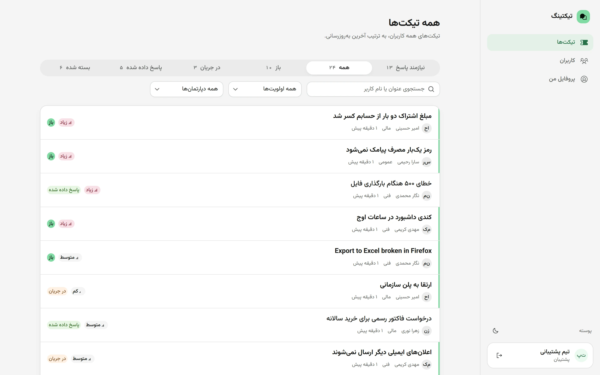
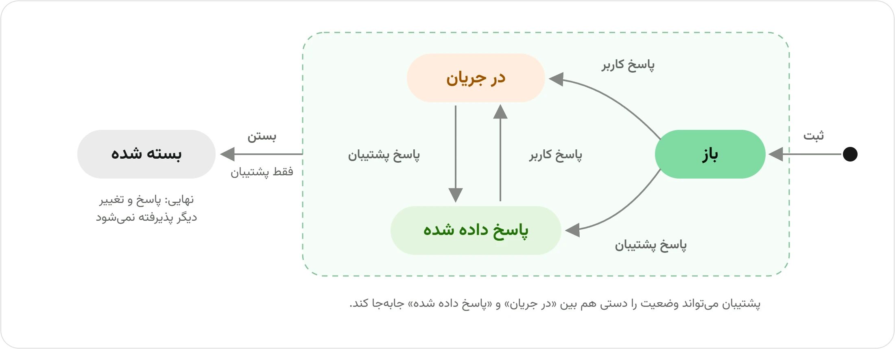
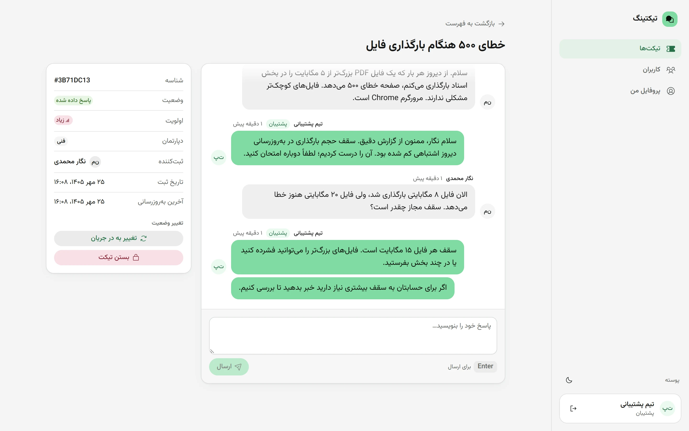
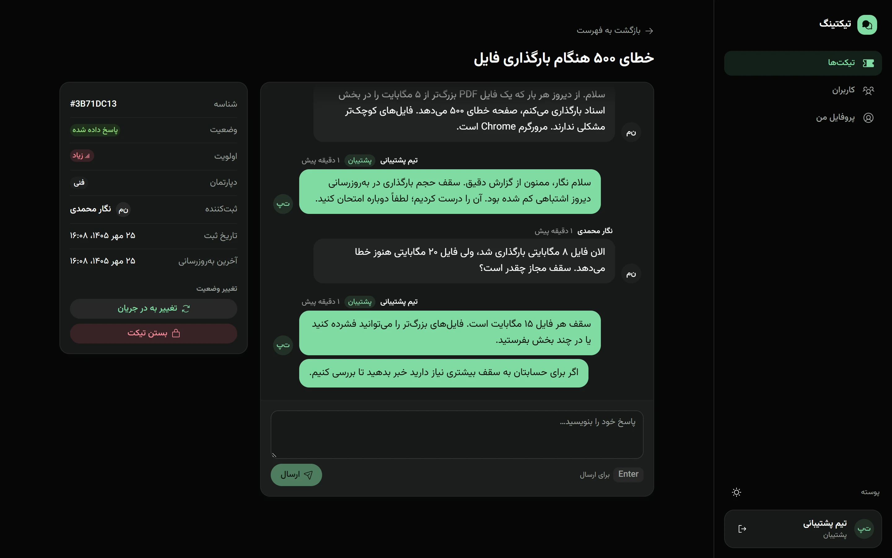
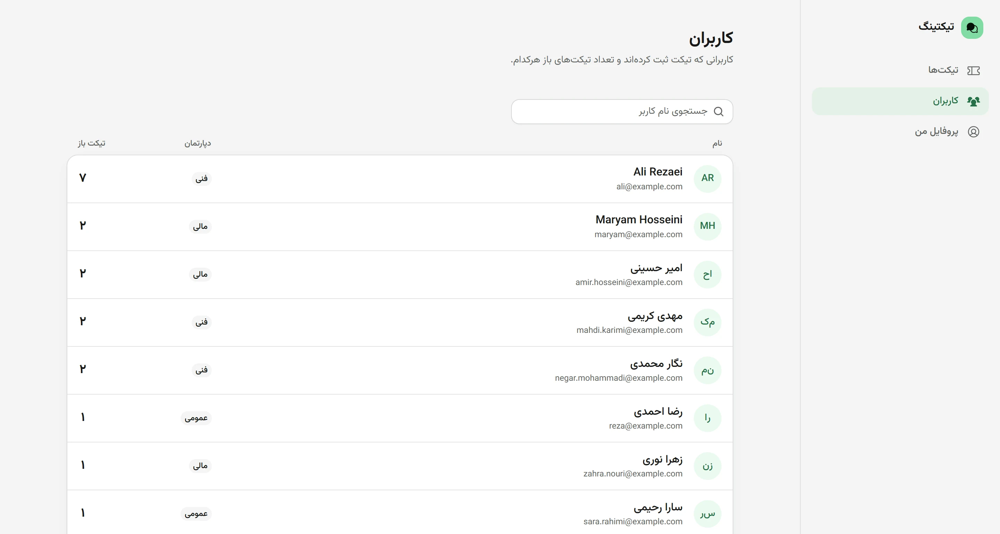
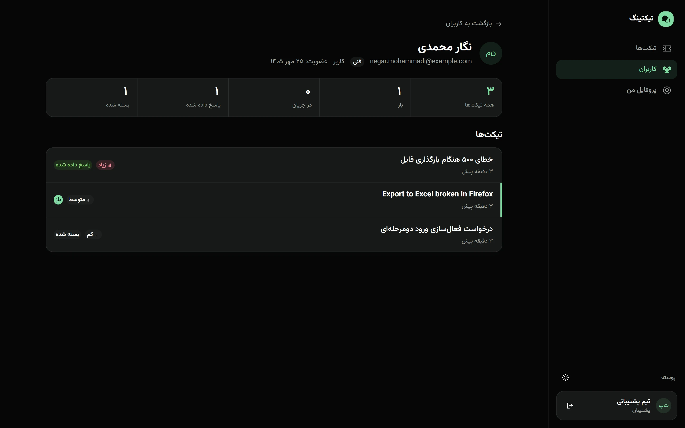
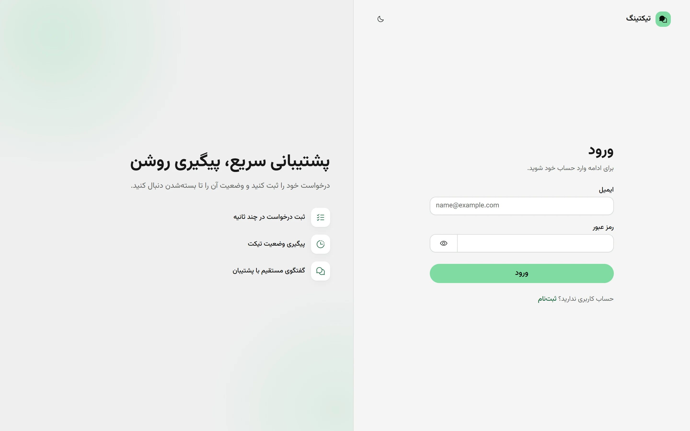
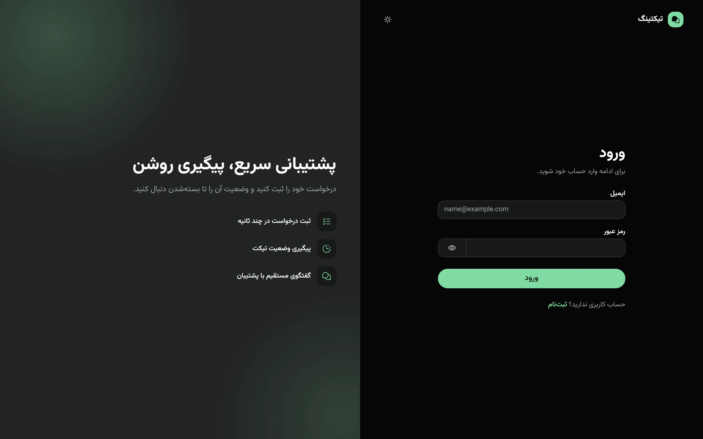
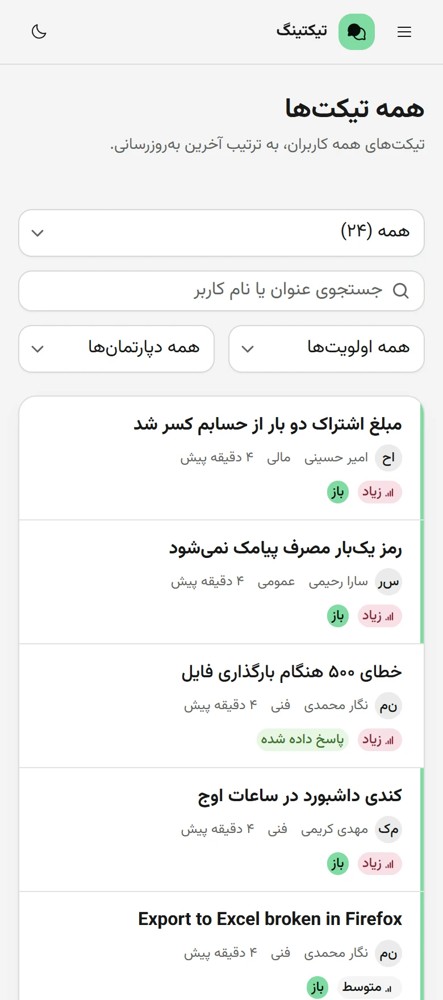
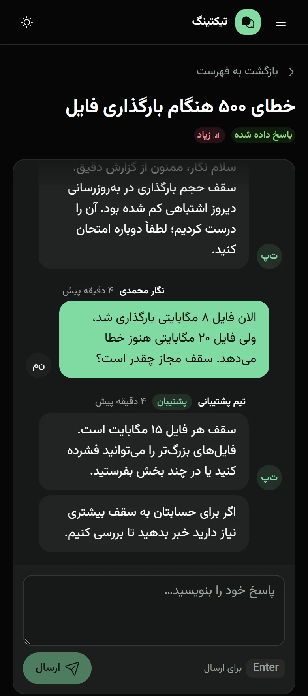

<div dir="rtl" lang="fa">

<div align="center">


# سامانه Ticketing

زیرسیستم پشتیبانی فارسی و راست‌به‌چپ: کاربران درخواست خود را به‌صورت Ticket ثبت می‌کنند و کارشناسان پشتیبانی به آن پاسخ می‌دهند.

<a href="https://ticketing.ariarzg.ir"></a> <a href="https://github.com/Ariarzg/ticketing-system-project/tags"></a>


**[نسخه زنده](https://ticketing.ariarzg.ir)** · **[نمای برنامه](#نمای-برنامه)** · **[تصمیم‌های طراحی](DECISIONS.fa.md)** · **[اجرای محلی](#اجرای-محلی)** · **[مراحل ساخت](#۴-مراحل-ساخت)**

</div>

<br>

<picture>
  <source media="(prefers-color-scheme: dark)" srcset="docs/images/agent-tickets-dark.webp">
  
</picture>

> 🔑 **حساب آزمایشی پشتیبان:** ایمیل <bdi dir="ltr">agent@ticketing.com</bdi> و رمز <bdi dir="ltr">Agent@1234</bdi>
>
> برای دیدن سامانه از نگاه کاربر، از صفحه ثبت‌نام یک حساب تازه بسازید. ثبت‌نام همیشه حساب کاربر می‌سازد و حساب پشتیبان فقط از راه seed ساخته می‌شود (تصمیم D21). نشانی جایگزین روی Vercel: <https://ticketing-system-project-steel.vercel.app>

## ۱. درباره این پروژه

این پروژه را برای «پروژه آزمایشی طراحی و پیاده‌سازی زیرسیستم Ticketing ساده» ساخته‌ام. شرح پروژه چهار چیز را ارزیابی می‌کند: درک نیازمندی، طراحی دیتابیس، منطق کسب‌وکار و رابط کاربری تمیز. هرجا شرح پروژه مبهم بود تصمیم گرفتم و دلیلش را نوشتم (بخش ۲).

### سیستم چه کار می‌کند

- 👥 **دو نقش:** کاربر و پشتیبان. ثبت‌نام همیشه حساب کاربر می‌سازد و نقش هرگز از ورودی درخواست خوانده نمی‌شود.
- 📝 **کاربر** Ticket را با عنوان، توضیحات و اولویت (کم، متوسط، زیاد) ثبت می‌کند، فقط Ticketهای خودش را می‌بیند و تا Ticket بسته نشده به آن پاسخ می‌دهد.
- 🎧 **پشتیبان** همه Ticketها را می‌بیند، بر اساس وضعیت، اولویت و دپارتمان فیلتر می‌کند، در عنوان و نام کاربر جستجو می‌کند، پاسخ می‌دهد، وضعیت را تغییر می‌دهد و Ticket را می‌بندد.
- 🔄 **چرخه حیات:** چهار وضعیت باز، در جریان، پاسخ داده شده و بسته شده. همه قوانین انتقال در یک تابع است و همه endpointها از همان استفاده می‌کنند.
- 💬 **گفتگو** داخل هر Ticket بدون بارگذاری دوباره صفحه به‌روز می‌شود.
- 🗂️ **کاربران:** پشتیبان فهرست کاربران و صفحه پروفایل هر کاربر را می‌بیند.
- 🌗 **رابط** فارسی و راست‌به‌چپ است، با تاریخ شمسی، پوسته روشن و تاریک، و چیدمان موبایل.

### چرخه حیات Ticket

<picture>
  <source media="(prefers-color-scheme: dark)" srcset="docs/images/lifecycle-dark.webp">
  
</picture>

هر پاسخ پشتیبان Ticket را «پاسخ داده شده» می‌کند و هر پاسخ کاربر آن را به «در جریان» برمی‌گرداند. پشتیبان می‌تواند وضعیت را دستی هم به «در جریان» یا «پاسخ داده شده» ببرد. فقط پشتیبان می‌بندد و «بسته شده» نهایی است؛ بعد از آن هیچ پاسخ یا تغییری پذیرفته نمی‌شود. همه این قوانین در `web/src/lib/lifecycle.ts` است (تصمیم‌های D1 تا D3).

### نمای برنامه

<table>
  <tr>
    <td width="50%" align="center"><br><sub>گفتگو و پنل وضعیت از نگاه پشتیبان</sub></td>
    <td width="50%" align="center"><br><sub>همان صفحه در پوسته تاریک</sub></td>
  </tr>
  <tr>
    <td align="center"><br><sub>فهرست کاربران با شمار Ticketهای باز</sub></td>
    <td align="center"><br><sub>پروفایل کاربر با شمارنده‌های وضعیت</sub></td>
  </tr>
  <tr>
    <td align="center"><br><sub>صفحه ورود</sub></td>
    <td align="center"><br><sub>صفحه ورود در پوسته تاریک</sub></td>
  </tr>
</table>

<p align="center">
  
  &nbsp;&nbsp;
  
  <br>
  <sub>نمای موبایل: فهرست Ticketها و گفتگو از نگاه کاربر</sub>
</p>

### جاهایی که شرح پروژه مبهم بود و تصمیم من

- **وضعیت‌ها:** شرح پروژه یک‌جا می‌گوید با اولین پاسخ پشتیبان وضعیت «در جریان» می‌شود و جای دیگر می‌گوید «پاسخ داده شده» یعنی پشتیبان منتظر کاربر است. این دو را با قانون نمودار بالا یکدست کردم.
- **بستن Ticket:** فقط پشتیبان می‌تواند ببندد و «بسته شده» نهایی است.
- **دپارتمان:** شرح پروژه فقط در فیلتر پشتیبان از آن نام می‌برد. سه دپارتمان ثابت (فنی، مالی و عمومی) تعریف کردم که کاربر هنگام ثبت‌نام انتخاب می‌کند و روی Ticketهایش ثبت می‌شود.

### نکات مهم برای ارزیاب

- 🔒 **دسترسی در سرور بررسی می‌شود، نه فقط در رابط کاربری.** Ticket یا پروفایلی که مال کاربر نیست از API پاسخ ۴۰۴ می‌گیرد، تا حتی معلوم نشود چنین شناسه‌ای وجود دارد.
- ⏱️ **گفتگو بدون WebSocket:** شرح پروژه قابلیت زمان‌واقعی نخواسته است، پس صفحه Ticket هر ۴ ثانیه و لیست هر ۱۰ ثانیه داده تازه را از سرور می‌گیرد (polling).
- 🧹 **بدون داده ساختگی:** دیتابیس نسخه زنده فقط با حساب پشتیبان شروع شد و هیچ کاربر یا Ticket ساختگی‌ای در آن نیست. داده تصویرهای بالا روی دیتابیس توسعه ساخته شده است.

### فناوری‌ها

پشته فناوری Next.js 16 (App Router و Route Handler) با Bun و TypeScript است، به همراه HeroUI v3 و Tailwind CSS v4 برای رابط، TanStack Query برای داده سمت مرورگر، Drizzle ORM با Postgres روی Neon، zod برای اعتبارسنجی، jose برای نشست JWT، و استقرار روی Vercel. دلیل هر انتخاب در فایل تصمیم‌ها آمده است.

### اجرای محلی

پیش‌نیازها Bun و یک دیتابیس Postgres (مثلاً یک branch در Neon) هستند. فایل `web/.env.example` را با نام `web/.env.local` کپی کنید و سه متغیر آن را پر کنید: `DATABASE_URL` (آدرس pooled برای برنامه)، `DATABASE_URL_UNPOOLED` (آدرس direct برای migration) و `JWT_SECRET`. سپس این دستورها را در پوشه `web` اجرا کنید:

<div dir="ltr">

```bash
bun install
bun run db:migrate
bun run db:seed
bun run dev
```

</div>

دستور seed فقط حساب پشتیبان را می‌سازد و اگر از قبل وجود داشته باشد کاری نمی‌کند. برنامه روی <bdi dir="ltr">http://localhost:3000</bdi> باز می‌شود.

### ساختار کد

همه کد برنامه در پوشه `web/` است:

- قوانین چرخه حیات Ticket: `src/lib/lifecycle.ts`
- دسترسی و نشست: `src/lib/auth.ts`، `src/lib/session.ts`، `src/lib/tickets.ts` و `src/proxy.ts`
- طرح دیتابیس، migration و seed: `src/db/` و `drizzle/`
- مسیرهای API: `src/app/api/` (برای auth، tickets و users)
- صفحه‌ها: `src/app/(auth)/` برای ورود و ثبت‌نام و `src/app/(app)/` برای بقیه
- متن‌های فارسی رابط: `src/lib/strings.fa.ts`
- توکن‌های طراحی و پوسته‌ها: `src/app/globals.css`

## ۲. تصمیم‌های طراحی

همه تصمیم‌های مهم، هرکدام با شماره و دلیل، در دو فایل هم‌محتوا آمده‌اند:

- نسخه فارسی: [DECISIONS.fa.md](DECISIONS.fa.md)
- نسخه انگلیسی: [DECISIONS.md](DECISIONS.md)

هر تصمیم شماره‌ای مثل D1 یا D9 دارد و در این README و در کد به همان شماره ارجاع داده می‌شود. فایل چهار بخش دارد:

- **محصول و چرخه حیات (D1 تا D4):** وضعیت‌ها، اینکه فقط پشتیبان می‌بندد، تابع واحد انتقال وضعیت، و معنی «نیازمند پاسخ».
- **کاربران و احراز هویت (D5 تا D8):** ثبت‌نام که همیشه کاربر می‌سازد، ورود با ایمیل و JWT در کوکی httpOnly، دپارتمان، و ساختار slug.
- **معماری (D9 تا D22):** polling، لایه‌های کنترل دسترسی، پشته فناوری، دو branch دیتابیس، رابط فارسی و راست‌به‌چپ، سیستم طراحی و چیدمان، نحوه seed شدن دیتابیس، و منطقه اجرای توابع روی Vercel.
- **مسیرها:** هر صفحه چه کسی را می‌پذیرد و چه نشان می‌دهد.

چند تصمیم که ارزش دارد اول خوانده شوند:

- **تصمیم‌های D1 و D2:** چطور تناقض شرح پروژه درباره وضعیت‌ها را حل کردم و چرا کاربر نمی‌تواند Ticket را ببندد.
- **تصمیم D3:** همه قوانین چرخه حیات در یک تابع هستند، نه پراکنده در endpointها.
- **تصمیم‌های D5 و D10:** نقش هیچ‌وقت از درخواست خوانده نمی‌شود و مالکیت Ticket داخل خود کوئری دیتابیس اعمال می‌شود.
- **تصمیم D9:** چرا polling و نه WebSocket.
- **تصمیم D21:** چرا دیتابیس نسخه زنده فقط یک حساب پشتیبان دارد.

## ۳. سیستم طراحی

رابط کاربری یک ابزار روزمره است، پس هدفم ظاهری آرام و یکدست بود. همه رنگ‌ها و اندازه‌ها از توکن‌های HeroUI در `web/src/app/globals.css` می‌آیند و هیچ کامپوننتی رنگ ثابت ندارد.

### رنگ

- **یک رنگ تأکید:** سبز نعنایی، `oklch(82% 0.12 155)` در هر دو پوسته. این رنگ فقط برای پس‌زمینه است: دکمه اصلی هر صفحه، لوگو و حباب پیام‌های خود کاربر، با متن تیره روی آن (کنتراست حدود ۱۲ به ۱).
- **متن به رنگ تأکید سبز تیره‌تر است:** لینک‌ها، گزینه فعال منو، دکمه‌های ثانویه و چیپ‌ها در پوسته روشن `oklch(49% 0.1 155)` دارند، چون خود رنگ نعنایی روی سفید فقط ۱٫۷ به ۱ است. در پوسته تاریک همان رنگ نعنایی خواناست.
- **رنگ‌های خنثی:** یک خانواده خاکستری با ته‌رنگ سبز بسیار کم برای پس‌زمینه، سطح کارت‌ها، متن کم‌رنگ و خطوط. متن کم‌رنگ در پوسته روشن `oklch(50% 0.003 155)` است و فیلدها لبه نازک دیدنی دارند.
- **کنتراست:** همه متن‌ها در هر دو پوسته دست‌کم ۴٫۵ به ۱ (استاندارد WCAG AA) و حلقه تمرکز دست‌کم ۳ به ۱. این مقدارها را با خواندن رنگ واقعی هر متن و پس‌زمینه‌اش روی هشت صفحه سنجیدم.
- **رنگ وضعیت‌ها معنی ثابت دارد:** «باز» نعنایی و توپر، «در جریان» زرد، «پاسخ داده شده» سبز و «بسته شده» خاکستری. اولویت رنگ جدا ندارد و با یک آیکون سیگنال نشان داده می‌شود؛ فقط اولویت «زیاد» قرمز است.

### پوسته روشن و تاریک

پیش‌فرض، تنظیم سیستم‌عامل کاربر است و دکمه پوسته انتخاب او را در `localStorage` نگه می‌دارد. یک اسکریپت کوچک در `<head>` پیش از اولین نمایش صفحه کلاس `dark` را روی `<html>` می‌گذارد، پس هنگام بارگذاری رنگ اشتباه دیده نمی‌شود.

### نوشتار و راست‌به‌چپ

- فونت **Vazirmatn** برای متن فارسی و لاتین، تا واژه‌های انگلیسی میان متن فارسی هماهنگ باشند.
- صفحه `lang="fa" dir="rtl"` است و جهت‌ها با ویژگی‌های منطقی Tailwind (`ms-`، `me-`، `text-start`) نوشته می‌شوند، نه راست و چپ فیزیکی.
- تاریخ‌ها شمسی و عددها فارسی هستند، با `Intl` خود مرورگر و بدون کتابخانه اضافه.
- متنی که کاربر می‌نویسد با `dir="auto"` نمایش داده می‌شود، پس پیام انگلیسی در صفحه فارسی درست خوانده می‌شود. عنوان‌ها و نام‌های یک‌خطی سمت راست می‌مانند و اگر بلند باشند از انتهای خودشان کوتاه می‌شوند. ایمیل‌ها همیشه چپ‌به‌راست هستند.
- فیلد خالی راست‌به‌چپ می‌ماند تا متن راهنمای فارسی درست دیده شود و بعد از تایپ جهتش را از متن می‌گیرد.
- کتابخانه React Aria که HeroUI روی آن ساخته شده، داخل `I18nProvider` با زبان `fa-IR` قرار دارد. بدون آن، جهت توست‌ها، فهرست‌های کشویی و کلیدهای جهت‌دار از زبان مرورگر پیروی می‌کرد.

### شکل، آیکون و حرکت

- **گوشه‌ها:** کارت‌ها و فیلدها گوشه نرم ۱۲ تا ۱۶ پیکسل دارند و دکمه‌ها و چیپ‌ها کاملاً گردند.
- **آیکون‌ها:** فقط Phosphor، یک خانواده و یک ضخامت. فقط گزینه فعال منو آیکون پُر دارد.
- **حرکت:** تنها انیمیشن یک محوشدن کوتاه همراه با کمی بالاآمدن برای محتوای صفحه و ردیف‌های لیست است و با تنظیم «کاهش حرکت» سیستم‌عامل اجرا نمی‌شود.

### چیدمان

- در دسکتاپ یک **نوار کناری** سمت راست و در موبایل یک **نوار بالا** با کشوی منو.
- فهرست Ticketها **ردیف‌های لیست** است، نه جدول، تا در موبایل درست زیر هم بیایند. ردیف‌هایی که منتظر پاسخ پشتیبان هستند یک نوار رنگی کنار خود دارند.
- **صفحه Ticket** گفتگو را کنار یک پنل اطلاعات (شناسه، وضعیت، اولویت، دپارتمان، تاریخ‌ها) نشان می‌دهد. در موبایل این پنل برای پشتیبان اول می‌آید تا کنترل وضعیت بدون اسکرول دیده شود، و برای کاربر بعد از گفتگو.
- **فیلترها** تب‌های وضعیت با شمارنده و یک نوار ابزار برای جستجو، اولویت و دپارتمان هستند. پشتیبان یک تب «نیازمند پاسخ» هم دارد. در موبایل یک فهرست کشویی جای تب‌ها را می‌گیرد.
- همه صفحه‌ها تا عرض ۳۷۵ پیکسل کار می‌کنند و برای هر صفحه حالت بارگذاری (اسکلت هم‌شکل با محتوا)، خالی و خطا در نظر گرفته شده است.

## ۴. مراحل ساخت

پروژه را نسخه‌به‌نسخه ساختم و هر نسخه یک برچسب گیت دارد. در هر نسخه اول API را ساختم و آزمودم و بعد رابط کاربری را. همه نسخه‌ها با `tsc --noEmit` و lint بدون خطا تمام شدند.

### نسخه v0.1: اسکلت برنامه

- وضعیت: **انجام شد**، برچسب `v0.1` (کامیت `5c1c8fc`).
- برنامه Next.js 16 در پوشه `web/` که با Bun اجرا می‌شود، با توکن‌های طراحی، دو پوسته، فونت Vazirmatn، Toast و TanStack Query. متن‌های فارسی، تاریخ شمسی و تابع ارتباط با API در `src/lib` هستند (تصمیم‌های D12، D15، D18 و D19).
- ارتباط با API یک تابع کوچک روی `fetch` خود مرورگر است؛ کتابخانه‌ای مثل axios لازم نبود.
- بررسی: build بدون خطا، و در مرورگر فونت، چینش راست‌به‌چپ، Toast و ماندن انتخاب پوسته.

### نسخه v0.2: دیتابیس

- وضعیت: **انجام شد**، برچسب `v0.2` (کامیت `63631b7`).
- پروژه Postgres روی Neon در فرانکفورت با دو branch جدا، `production` و `dev` (تصمیم D13).
- طرح دیتابیس در `src/db/schema.ts`: سه جدول کاربران، Ticketها و پیام‌ها (تصمیم D17)، چهار enum برای نقش، دپارتمان، اولویت و وضعیت، و ایندکس روی ستون‌هایی که فیلتر و مرتب می‌شوند. دپارتمان روی خود Ticket هم ذخیره می‌شود تا فیلتر یک شرط ساده باشد (تصمیم D7).
- اسکریپت seed فقط حساب پشتیبان را می‌سازد، چیزی پاک نمی‌کند و اجرای دوباره‌اش بی‌خطر است (تصمیم D21).
- مشکل: drizzle-kit با Node اجرا می‌شد و Node فایل `.env.local` را نمی‌خواند. اسکریپت‌ها را به `bun run --bun drizzle-kit` تغییر دادم.

### نسخه v0.3: احراز هویت و اولین استقرار

- وضعیت: **انجام شد**، برچسب `v0.3` (کامیت `e4959fb`).
- چهار endpoint ثبت‌نام، ورود، خروج و `me` در `src/app/api/auth/`. طرح اعتبارسنجی ثبت‌نام اصلاً فیلد نقش ندارد (تصمیم D5) و رمز با `Bun.password` هش می‌شود.
- نشست یک JWT یک‌روزه در کوکی httpOnly است (تصمیم D6). تابع `requireUser` پاسخ ۴۰۱ و `requireAgent` پاسخ ۴۰۳ می‌دهد (تصمیم D10)، و `src/proxy.ts` فقط بازدیدکننده بدون کوکی را به `/login` می‌فرستد (تصمیم D14).
- صفحه‌های ورود و ثبت‌نام و پوسته برنامه با نوار کناری و کشوی منو (تصمیم D20).
- استقرار روی Vercel با پوشه ریشه `web`: هر push به `main` نسخه زنده را می‌سازد، Production به branch `production` دیتابیس وصل است و Preview به `dev`. توابع در فرانکفورت (`fra1`) کنار دیتابیس اجرا می‌شوند (تصمیم D22).
- مشکل: در سرور توسعه روی ویندوز، Bun نام مستعار هش‌دار پکیج `pg` را پیدا نمی‌کرد و همه routeهای دیتابیس ۵۰۰ می‌دادند. با `transpilePackages: ["pg"]` حل شد.
- بررسی: آزمون‌های دستی روی سرور محلی و نسخه زنده. ثبت‌نام با `role: agent` حساب کاربر ساخت، ایمیل تکراری ۴۰۹ و ورودی نامعتبر ۴۰۰ گرفت و کوکی روی نسخه زنده هم `HttpOnly` بود و هم `Secure`.

### نسخه v0.4: تابع چرخه عمر Ticket

- وضعیت: **انجام شد**، برچسب `v0.4` (کامیت `0a68dc7`).
- تابع خالص `transition` در `src/lib/lifecycle.ts`، تنها جای قوانین وضعیت (تصمیم D3). وضعیت فعلی، عمل و نقش را می‌گیرد و وضعیت بعدی را برمی‌گرداند یا یکی از سه خطای `ticket_closed`، `forbidden` و `invalid_transition` را می‌دهد (تصمیم‌های D1 و D2).
- بررسی: اسکریپت `scripts/check-lifecycle.ts` هجده حالت را با `node:assert` امتحان می‌کند. برای اطمینان از خود اسکریپت، یک قانون را موقتاً خراب کردم و اسکریپت دقیقاً روی همان حالت شکست خورد.

### نسخه v0.5: ثبت و مشاهده Ticket توسط کاربر

- وضعیت: **انجام شد**، برچسب `v0.5` (کامیت `1104961`).
- قوانین دسترسی در `src/lib/tickets.ts`: محدوده دیدن داخل کوئری اعمال می‌شود (لایه سوم تصمیم D10) و Ticket دیگران مثل Ticket ناموجود ۴۰۴ می‌گیرد (تصمیم D11).
- مسیرهای لیست، ساخت و خواندن Ticket. فقط کاربر Ticket می‌سازد و دپارتمانش روی Ticket کپی می‌شود.
- صفحه‌های لیست، ثبت Ticket و صفحه یک Ticket. اگر API پاسخ ۴۰۴ بدهد، پیام «دسترسی غیرمجاز» می‌آید و کاربر به لیست برمی‌گردد.
- مشکل‌ها: ساعت عقب کامپیوتر زمان Ticket تازه را «۲ دقیقه بعد» نشان می‌داد، که حالا «اکنون» است. فرم ثبت Ticket هم حالا حداقل طول عنوان و توضیحات را پیش از ارسال زیر همان فیلد اعلام می‌کند.
- بررسی: هشت آزمون API با دو کاربر آزمایشی روی سرور توسعه و build، و مرور صفحه‌ها در مرورگر در عرض دسکتاپ و موبایل.

### نسخه v0.6: گفتگو و پاسخ‌ها

- وضعیت: **انجام شد**، برچسب `v0.6` (کامیت `04f3df5`).
- مسیر پیام‌ها در `src/app/api/tickets/[id]/messages/route.ts`. ثبت پاسخ در یک تراکنش انجام می‌شود که ردیف Ticket را با `for update` قفل می‌کند، وضعیت بعدی را از تابع چرخه عمر می‌گیرد و در صورت هر خطا چیزی ذخیره نمی‌کند (تصمیم‌های D1 تا D3).
- کامپوننت `Thread`: توضیحات Ticket اولین حباب است (تصمیم D17) و گفتگو هر ۴ ثانیه به‌روز می‌شود (تصمیم D9). در دسکتاپ Enter می‌فرستد و Shift+Enter خط تازه می‌سازد.
- بررسی: شش آزمون API، و در مرورگر رسیدن پاسخ طرف مقابل در کمتر از پنج ثانیه بدون بارگذاری دوباره، همراه با تغییر وضعیت.

### نسخه v0.7: همه Ticketها برای پشتیبان و تغییر وضعیت

- وضعیت: **انجام شد**، برچسب `v0.7` (کامیت `7a837ee`).
- مسیر `PATCH` تغییر وضعیت فقط برای پشتیبان است (لایه دوم تصمیم D10) و مثل ثبت پاسخ در یک تراکنش با قفل ردیف کار می‌کند.
- کامپوننت `StatusControl` در پنل اطلاعات برای هر وضعیت مجاز یک دکمه دارد. بستن پیش از اجرا تأیید می‌گیرد، چون برگشت‌پذیر نیست.
- بررسی: شش آزمون API (تغییر توسط کاربر ۴۰۳، همان وضعیت ۴۰۹، هر کاری روی Ticket بسته ۴۰۹) و کل چرخه از «باز» تا «بسته شده» در مرورگر.

### نسخه v0.8: فیلتر، جستجو و صفحه‌بندی

- وضعیت: **انجام شد**، برچسب `v0.8` (کامیت `80777b8`).
- همه فیلترها روی سرور اجرا می‌شوند: وضعیت، اولویت، دپارتمان، «نیازمند پاسخ»، جستجو و صفحه‌های ده‌تایی، که با `AND` ترکیب می‌شوند و همیشه داخل محدوده دسترسی کاربر می‌مانند (تصمیم D10). پاسخ شمار Ticketها در هر وضعیت را هم دارد (تصمیم D4).
- جستجو برای پشتیبان در عنوان و نام نویسنده است و برای کاربر فقط در عنوان. تابع `likePattern` نویسه‌های `%` و `_` را خنثی می‌کند.
- فیلترها در آدرس صفحه می‌مانند، پس بارگذاری دوباره و دکمه برگشت آن‌ها را حفظ می‌کنند.
- مشکل: «پاک کردن فیلترها» متن قبلی جستجو را بعد از لحظه‌ای به آدرس برمی‌گرداند. حالا کادر جستجو با آدرس هماهنگ می‌شود.
- بررسی: ده آزمون API و همه تب‌ها، فیلترها، جستجو و صفحه‌بندی در مرورگر برای هر دو نقش.

### نسخه v0.9: صفحه‌های کاربران

- وضعیت: **انجام شد**، برچسب `v0.9` (کامیت `e79c865`).
- مسیر `GET /api/users` فقط برای پشتیبان است و شمار Ticketهای بسته‌نشده هر کاربر را در همان یک کوئری حساب می‌کند. پروفایل یک کاربر را فقط خودش و پشتیبان می‌بینند و بقیه ۴۰۴ می‌گیرند (تصمیم D11).
- صفحه‌های `/users` و `/users/{slug}` با شمارنده‌های وضعیت و فهرست Ticketهای کاربر.
- بررسی: هشت آزمون API، و جدول کامل دسترسی برای هر هشت مسیر در سه حالت (بدون ورود، کاربر، پشتیبان) که با طراحی یکی بود.

### نسخه v1.0: صیقل نهایی و انتشار

- وضعیت: **انجام شد**، برچسب `v1.0` (کامیت `6f7255f`) که روی Vercel منتشر شد.
- صفحه ۴۰۴ و صفحه خطای زمان اجرا با دکمه «تلاش دوباره». حالت‌های بارگذاری، خالی و خطا در همه صفحه‌ها مرور شد.
- کوکی نشست جعلی پاسخ ۴۰۱ گرفت (تصمیم D6). راست‌به‌چپ، رقم فارسی، تقویم جلالی و عرض ۳۷۵ پیکسل بدون اسکرول افقی در مرورگر بررسی شد.
- مشکل: کارت لیست‌ها حلقه تمرکز ردیف‌ها را می‌برید. حالا حلقه داخل خود ردیف کشیده می‌شود.

### پس از v1.0: حالت بارگذاری روی دکمه‌ها

- وضعیت: **انجام شد** (کامیت `150f535`).
- کامپوننت `LoadingButton` تا پایان هر درخواست چرخنده نشان می‌دهد و فشار دوباره را نمی‌پذیرد. ورود، ثبت‌نام، ثبت Ticket، ارسال پاسخ، تغییر وضعیت، خروج و «تلاش دوباره» از آن استفاده می‌کنند.
- بررسی: با درخواست‌های سه‌ثانیه‌ای در مرورگر، سه کلیک روی ورود و ثبت‌نام فقط یک درخواست فرستاد و از دکمه‌های وضعیت فقط دکمه فشرده‌شده چرخید.

### پس از v1.0: بازبینی رابط کاربری و پوسته نعنایی

- وضعیت: **انجام شد** (کامیت‌های `61ae024` و `29fddff`).
- همه صفحه‌ها را در هر دو نقش، هر دو پوسته، موبایل و دسکتاپ و با زبان مرورگر انگلیسی و فارسی مرور کردم و هر مشکل را اصلاح کردم.
- رنگ تأکید از کبالتی به نعنایی تغییر کرد و رنگ‌های متن برای کنتراست تیره‌تر شدند (تصمیم D18). با `I18nProvider` جهت توست‌ها و فهرست‌ها در مرورگر انگلیسی هم راست‌به‌چپ شد (تصمیم D15).
- خطاهای فارسی زیر فیلدهای ورود و ثبت‌نام، دکمه نمایش رمز، شمارنده کاراکتر، پنجره تأیید فارسی برای بستن، گروه‌شدن پیام‌های پشت‌سرهم، شمارنده‌هایی که فیلترها را دنبال می‌کنند (تصمیم D20) و چند بهبود دسترسی‌پذیری مثل پیوند «پرش به محتوای اصلی».
- مشکل استقرار: cache بیلد Turbopack روی Vercel فایل CSS پوسته قدیمی را برمی‌گرداند. آن را در `next.config.ts` خاموش کردم. آیکون سایت هم از هدایت به صفحه ورود مستثنا شد.

### پس از v1.0: دامنه اختصاصی

- وضعیت: **انجام شد**.
- نسخه زنده حالا روی <bdi dir="ltr">ticketing.ariarzg.ir</bdi> است و نشانی Vercel هم همچنان کار می‌کند.
- بررسی: روی دامنه تازه، آدرس `/` با کد ۳۰۷ به `/login` می‌رود و صفحه ورود با کد ۲۰۰ باز می‌شود.

### آنچه هنوز بررسی نشده یا باز است

- دو پنجره هم‌زمان کاربر و پشتیبان روی یک Ticket را امتحان نکردم؛ طرف دیگر گفتگو را با درخواست مستقیم به API بازی کردم.
- چرخنده دکمه‌های ثبت Ticket، بستن و «تلاش دوباره» را در مرورگر ندیدم.
- بعد از بازبینی رابط، ارسال واقعی پاسخ، بستن، ثبت‌نام کامل و ثبت Ticket را دوباره اجرا نکردم تا داده‌ای در دیتابیس ساخته نشود.
- رفتار Enter روی گوشی واقعی، صفحه‌خوان واقعی و تنظیم «کاهش حرکت» سیستم‌عامل را امتحان نکردم.
- آزمون نهایی کامل روی سایت زنده (ثبت‌نام، ثبت Ticket و گفتگو) هنوز انجام نشده است.
- دو کلید Enter که سریع‌تر از یک بار رندر React برسند پاسخ را دو بار ثبت می‌کنند. این فقط با ورودی خودکار دیده شد و راه حلش یک پرچم در `useRef` است که هنوز اعمال نشده.

---

<p align="center"><sub>ساخته‌شده توسط Aria Rouzegar، نسخه‌به‌نسخه از v0.1 تا v1.0</sub></p>

</div>
